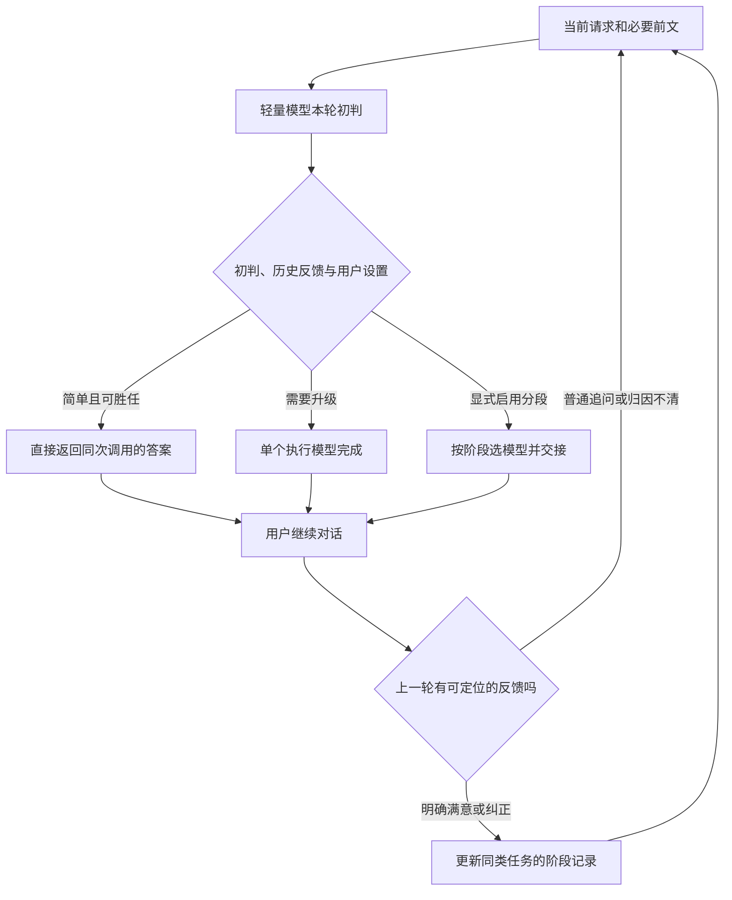

# 为什么这样路由

我们最初问的是一个很实际的问题：如果一份工作只有最后一句结论需要强推理，为什么前面整理材料也要付同样的代价？后来遇到的反例更重要。对完成得已经很好的常规任务，分类器重读题面、交接模型重读上下文、复核模型再写一遍，都是真实开销。因此每轮保留一次模型判断，但允许这个判断与作答发生在同一次调用里。

## 从整题选档到局部纠错

1. **冷启动靠通用工序。** 给使用者的是查询、校验、判断、表达等通用阶段和少量档位说明。由使用者绑定的轻量模型阅读实际请求。一个人的评测集、纠错记录和模型排名无需迁移给另一个人。
2. **拆分要能改变交付。** 例如把两列数相加，有确定算法时由宿主执行并核对。换成“不同来源采用了不同的分母，按哪个数做决定”，才需要处理证据冲突。材料多、文件大、篇幅长，都不足以单独构成升档理由。接入方有计算或检索工具时应真实调用；本仓库默认执行器只接收文本。
3. **从用户的下一句话找证据。** “再给我一张表”只是延伸；“这次对了，退货扣得准确”能强化对应核算；“本月取成上月，表头日期已经标明”提示可能是取数错误。若源表迟到、权限失败或用户刚改口径，要先处理数据、工具或偏好。只有能定位到已执行阶段的模型失误才改变选模。整题由一个模型完成时，能观察到的阶段粒度也相应有限。
4. **把个人偏好与个人路由拆开验证。** 同样一份摘要，财务受众关心净额，运营受众关心订单量。“下一次仍按净额汇报”属于需求记忆；“净额解释反复返工，下次把核验交给另一档”才改变路由。同一人的不同受众也可分开命名。适合先观察的是重复交付且能指出返工环节的工作，例如经营周报；偶尔一次的文件改名几乎没有学习样本。
5. **给新模型和低档模型机会。** 发布新模型后，使用者可绑定候选并打开探索。小比例普通风险请求试用，显示探索标记。若不愿继续承担试错成本，关闭探索即可。候选的上限、成本和适配效果仍需在自己的任务上实测。当前策略更新本地记录和选档，不训练基础模型权重。

## 产品定位与适用对象

当一类交付会反复发生、验收条件明确，而且团队能分清返工来自哪个步骤时，可以用这套路由记录选模和反馈。它允许使用者绑定可调用的模型，为关键请求手动升档，并在普通风险任务中用明确反馈决定是否采用或回退候选。默认只做一次轻量初判，能直接答就同次交付，其余通常交给单个执行模型。显式分段适合中间产物可以独立验收、交接足以改变结果的工作。

| 使用场景 | 谁可能受益 | 怎样使用 |
|---|---|---|
| 同一类交付每周都要做，返工原因可以定位 | 维护报表、目录或客服质检流程的团队 | 用路由替换手工选档或写死的模型映射，先测首次验收通过率与人工修改时间 |
| 产品通过自己的接口调用多个模型，要求保留手动覆盖和用量记录 | 负责模型接入、质量或成本的内部工具团队及产品开发者 | 将路由接在已授权的模型接口前，限定哪些任务可以探索，单独保留固定档作为回退路径 |
| 偶发任务、验收标准经常变化，或平台原生 Auto 已稳定满足要求 | 直接使用平台的个人和团队 | 沿用原生 Auto。固定轻量或固定中档也能稳定达标时，可直接选固定档，省去分类与维护开销 |

可能的采购或内部立项人是同时对返工和模型用量负责的流程负责人，例如内部工具团队的负责人。只有节省的人工返工或模型支出足以覆盖接入、分类与维护，才有持续投入的理由。

例如，虚构的灰榆社区剧团每周把排练申请整理成设备借用清单。大部分工作是按模板转写，轻量模型即可交付。若申请表和场地表列了不同的归还日期，团队可以单独把核验交给更合适的模型。如果返工来自上游漏填，先补源记录。只有确认模型漏看了已提供的日期，才计作该核验阶段的选模反馈。

### 与原生 Auto 的重叠与互补

平台 Auto 面向把任务交给平台的用户。它最直接的价值是免配置：打开默认模式就可以开始工作。站在使用者一侧，一次出错的代价因岗位和交付对象而异：一处措辞花半分钟就能改，一处证据用错可能让同事重新核一遍整张表。本项目允许维护工作流的人把这种差别变成下一次实际执行的规则。对 Auto 后端使用了哪个模型、如何权衡成本与质量，本次记录无法给出答案。[WorkBuddy 官方模型选择说明](https://www.codebuddy.cn/docs/workbuddyapp/features/Model)

两者都减少逐条手选模型的操作。在已有平台内完成的日常任务，可以继续走原生 Auto。需要显式绑定模型、查阅每次执行档位、限定探索或保留阶段反馈的重复流程，可以走自己的路由。原生 Auto 也可以做并行对照，帮助判断这些额外控制是否减少返工。本仓库的执行器使用可配置的兼容接口，平台的账户、数据和工具能力仍由相应平台或宿主提供。

同一套 30 道题分别在 5 组策略上实跑。每份答案按 0–2 分盲评，得 2 分表示主要要求均满足、可直接使用。达到这个标准的数量为固定轻量 18/30、固定中档 17/30、固定高档 19/30、路由 19/30、原生 Auto 15/30。相对原生 Auto，这轮路由多通过 4 题，可见 token 总量约 190.23 万对 153.34 万（多约 24.1%），逐题累计调用耗时的中位数为 103 秒对 71 秒（多约 45.1%）。实扣积分和平台后端调度均未知。这组观察可以描述样本里的通过数与开销，框架在新任务上的可重复收益和跨轮个性化的额外增益仍待验证。

### 哪些结果值得付费

对普通用户，多维护一套规则的成本很直观；对负责交付的团队，一轮返工会占用好几个人的时间。是否值得付费，可以按一个报告周期算账：节省的人工复核与返工成本，能否覆盖新增模型调用、等待以及维护规则的成本，同时守住关键错误率。星标、调用次数和回答篇幅都无法代替这笔账。

现有实现可供个人使用，也可嵌入已有工作流。长期个性化最值得做的对照，是让原生 Auto 和本路由获得相同的历史偏好、材料和工具，在规则锁定后的新一期交付上记录首次验收、实际修改分钟数和实扣积分。若固定轻量或原生 Auto 已经连续达标，就继续沿用；若只有证据核验反复返工，就先检验只替换这一步能带来多少改善。

## 用什么证据决定继续投入

一次答错可能来自抽样波动，一次重答也可能恰好答对。评估选档本身时，先固定各模型的原答，比较改变选择能改善多少；再对不同模型重复实跑，测实际交付的波动。用于找规律的旧题与规则锁定后的新题分开报告。模型调用次数、文件数或输出字节只能帮助解释成本，不能换算成实付积分。

为区分个人记忆和路由，给三个条件相同的数据、工具、模板与验收标准：原生 Auto、原生 Auto 加个人偏好、自适应路由加同一份偏好。后两组的差额才有助于识别个性化选档的增益。另设固定中档作为是否值得增加复杂度的直接对照。对经常返工的交付，记录首次验收通过率、人工修改分钟数，以及全部尝试和失败在内的每份合格交付成本。

成本上的盈亏线很简单：降档省下的钱，必须覆盖初判、重复上下文、交接、复核、探索和重做。早期办公复盘中，分配已知的整题选档看似便宜，纳入逐题分类后优势消失；部分文件增加交接也没有改善验收。另一些直接影响决策的开放题值得升级。由此保留可调整的机制，将“稳定优于固定中档或平台 Auto”留给新任务和真实账单验证。

分享讨论里有一笔能说明问题的拆账。在那轮 60 个模拟办公任务的完整 CSV 计价情景里，按分类器的选择回放原答，执行部分相对固定中档少用 0.230250 个标准等价积分；逐题分类本身用了 0.239925。合计多用 0.009675，且通过数从 60 变为 59。这是按可见输入输出复算的同口径估算，执行部分复用了固定原答，不能充当 WorkBuddy 账单或新版本实测。它解释了为什么默认路径要合并“判定”和“能直接完成的工作”，也解释了为什么项目会保留固定中档这个对照。

现阶段把项目作为可运行、可检验的方法公开。外部复用、具体返工案例和真实开销值得跟踪。星标可以反映关注度；是否恢复商业投入，则看相同质量下能否持续少返工或降低合格交付成本。
