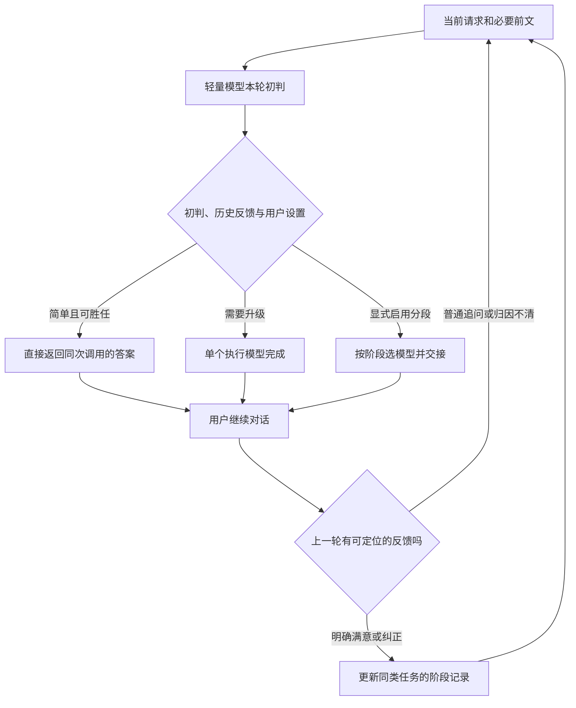

# 为什么这样路由

我们最初问的是一个很实际的问题：如果一份工作只有最后一句结论需要强推理，为什么前面整理材料也要付同样的代价？后来遇到的反例更重要。对完成得已经很好的常规任务，分类器重读题面、交接模型重读上下文、复核模型再写一遍，都是真实开销。因此每轮保留一次模型判断，但允许这个判断与作答发生在同一次调用里。

## 从整题选档到局部纠错

1. **冷启动靠通用工序。** 给使用者的是查询、校验、判断、表达等通用阶段和少量档位说明。由使用者绑定的轻量模型阅读实际请求。一个人的评测集、纠错记录和模型排名无需迁移给另一个人。
2. **拆分要能改变交付。** 例如把两列数相加，有确定算法时由宿主执行并核对。换成“不同来源采用了不同的分母，按哪个数做决定”，才需要处理证据冲突。材料多、文件大、篇幅长，都不足以单独构成升档理由。接入方有计算或检索工具时应真实调用；本仓库默认执行器只接收文本。
3. **从用户的下一句话找证据。** “再给我一张表”只是延伸；“这次对了，退货扣得准确”能强化对应核算；“本月取成上月，表头日期已经标明”提示可能是取数错误。若源表迟到、权限失败或用户刚改口径，要先处理数据、工具或偏好。只有能定位到已执行阶段的模型失误才改变选模。整题由一个模型完成时，能观察到的阶段粒度也相应有限。
4. **把个人偏好与个人路由拆开验证。** 同样一份摘要，财务受众关心净额，运营受众关心订单量。“下一次仍按净额汇报”属于需求记忆；“净额解释反复返工，下次把核验交给另一档”才改变路由。同一人的不同受众也可分开命名。适合先观察的是重复交付且能指出返工环节的工作，例如经营周报；偶尔一次的文件改名几乎没有学习样本。
5. **给新模型和低档模型机会。** 发布新模型后，使用者可绑定候选并打开探索。小比例普通风险请求试用，显示探索标记。若不愿继续承担试错成本，关闭探索即可。候选的上限、成本和适配效果仍需在自己的任务上实测。当前策略更新本地记录和选档，不训练基础模型权重。

## 用什么证据决定继续投入

一次答错可能来自抽样波动，一次重答也可能恰好答对。评估选档本身时，先固定各模型的原答，比较改变选择能改善多少；再对不同模型重复实跑，测实际交付的波动。用于找规律的旧题与规则锁定后的新题分开报告。模型调用次数、文件数或输出字节只能帮助解释成本，不能换算成实付积分。

为区分个人记忆和路由，给三个条件相同的数据、工具、模板与验收标准：原生 Auto、原生 Auto 加个人偏好、自适应路由加同一份偏好。后两组的差额才有助于识别个性化选档的增益。另设固定中档作为是否值得增加复杂度的直接对照。对经常返工的交付，记录首次验收通过率、人工修改分钟数，以及全部尝试和失败在内的每份合格交付成本。

成本上的盈亏线很简单：降档省下的钱，必须覆盖初判、重复上下文、交接、复核、探索和重做。早期办公复盘中，分配已知的整题选档看似便宜，纳入逐题分类后优势消失；部分文件增加交接也没有改善验收。另一些直接影响决策的开放题值得升级。由此保留可调整的机制，将“稳定优于固定中档或平台 Auto”留给新任务和真实账单验证。

分享讨论里有一笔能说明问题的拆账。在那轮 60 个模拟办公任务的完整 CSV 计价情景里，按分类器的选择回放原答，执行部分相对固定中档少用 0.230250 个标准等价积分；逐题分类本身用了 0.239925。合计多用 0.009675，且通过数从 60 变为 59。这是按可见输入输出复算的同口径估算，执行部分复用了固定原答，不能充当 WorkBuddy 账单或新版本实测。它解释了为什么默认路径要合并“判定”和“能直接完成的工作”，也解释了为什么项目会保留固定中档这个对照。

现阶段把项目作为可运行、可检验的方法公开。外部复用、具体返工案例和真实开销值得跟踪。星标可以反映关注度；是否恢复商业投入，则看相同质量下能否持续少返工或降低合格交付成本。
